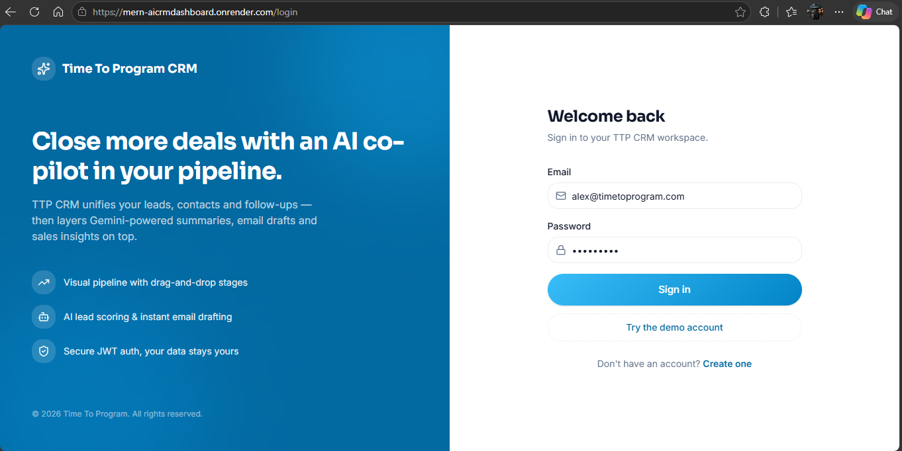
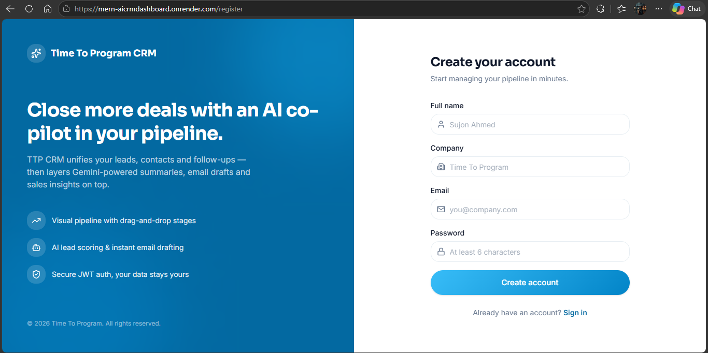
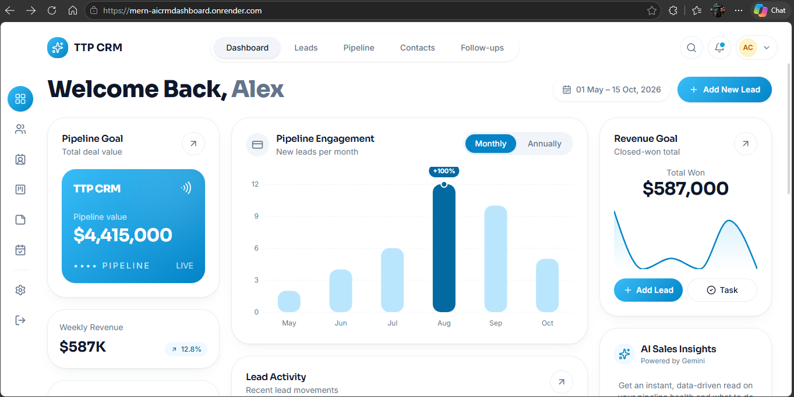
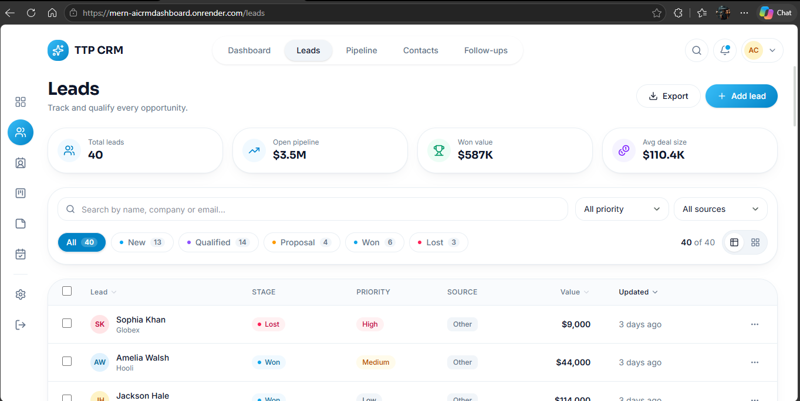
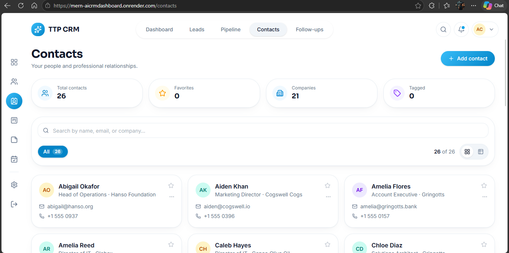
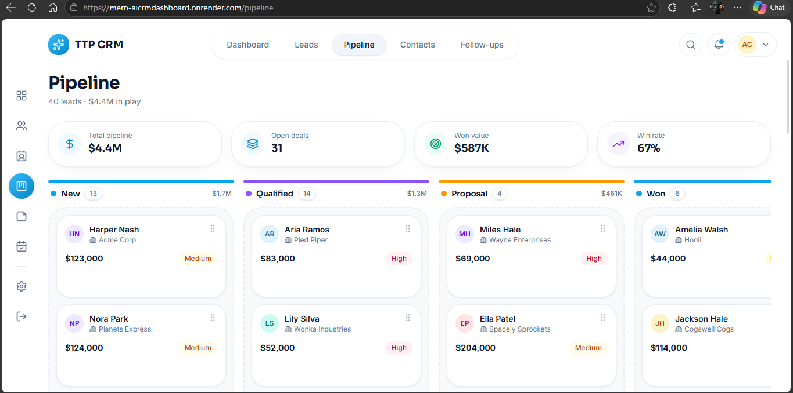
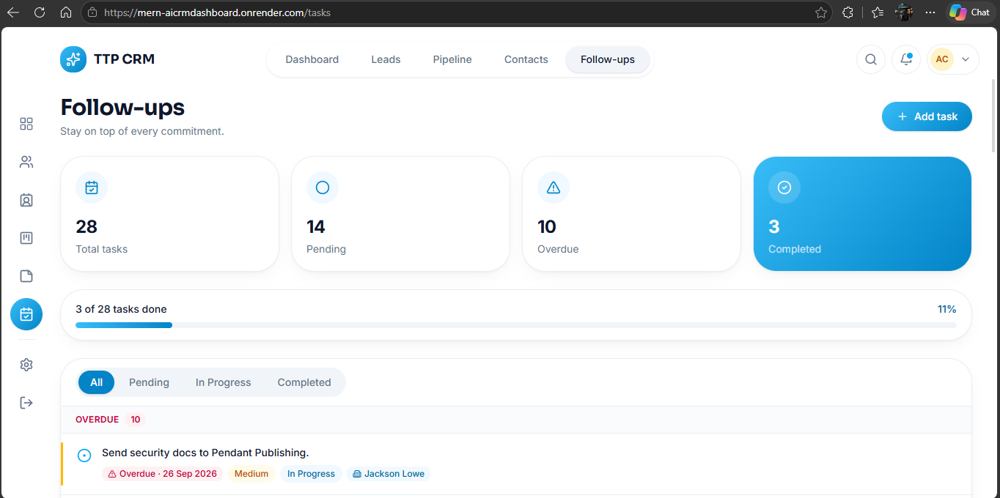
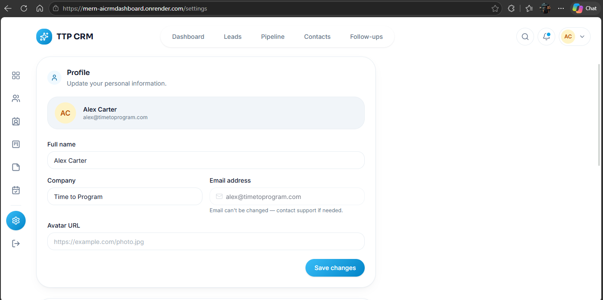

# TTP CRM

TTP CRM is a full-stack customer relationship management dashboard for tracking sales leads, contacts, pipeline activity, notes, and follow-up tasks. It is built with React, Express, and MongoDB, with optional Google Gemini features for AI-generated sales content.

## Contents

- [Features](#features)
- [Technology](#technology)
- [Project structure](#project-structure)
- [Getting started](#getting-started)
- [Environment variables](#environment-variables)
- [Available scripts](#available-scripts)
- [Demo data](#demo-data)
- [API overview](#api-overview)
- [Deploy to Render](#deploy-to-render)
- [Troubleshooting](#troubleshooting)
- [Security](#security)

## Features

- User registration and sign-in with JWT authentication
- Dashboard overview and sales analytics
- Lead management with pipeline stages, prioritization, and reordering
- Contact management
- Notes and follow-up task management
- AI lead summaries, email drafts, and pipeline insights through Google Gemini (optional)
- Responsive React interface

## Technology

- **Frontend:** React 19, Vite 8, React Router, Tailwind CSS, Axios, Recharts
- **Backend:** Node.js, Express 4, Mongoose, JSON Web Tokens, bcrypt
- **Database:** MongoDB
- **AI integration:** Google Gemini API (optional)

## Project structure

```text
.
├── backend/
│   ├── config/          # MongoDB connection
│   ├── controllers/     # API request handlers
│   ├── middleware/      # Authentication and error handling
│   ├── models/          # Mongoose schemas
│   ├── routes/          # Express API routes
│   ├── services/        # Gemini integration
│   ├── server.js        # API server and production frontend hosting
│   └── seed.js          # Optional demo data generator
├── frontend/
│   ├── src/             # React application
│   └── public/          # Static public assets
├── package.json         # Root build and start commands
└── README.md
```

## Getting started

### Prerequisites

- Node.js **20.19+** or **22.12+** and npm (required by the installed Vite 8 version)
- A MongoDB database, either local or hosted (for example, MongoDB Atlas)
- A Gemini API key only if you want to use the AI features

### 1. Install dependencies

Run these commands from the repository root:

```bash
npm install --prefix backend
npm install --prefix frontend
```

### 2. Configure the backend

Create `backend/.env`:

```dotenv
MONGO_URI=mongodb://127.0.0.1:27017/ttp-crm
JWT_SECRET=replace-with-a-long-random-secret
JWT_EXPIRES_IN=7d
NODE_ENV=development
CLIENT_URL=http://localhost:5173

# Optional: enables Gemini-powered features
GEMINI_API_KEY=your-gemini-api-key
# Optional; defaults to gemini-2.5-flash
GEMINI_MODEL=gemini-2.5-flash
```

`MONGO_URI` and `JWT_SECRET` are required. The other variables are optional; defaults are listed in the table below. For MongoDB Atlas, use the Atlas connection string as `MONGO_URI` and make sure the database user and network access rules permit the app to connect.

### 3. Start the app in development

Run the backend and frontend in separate terminals, both opened at the repository root.

**Terminal 1 — backend API:**

```bash
npm run dev --prefix backend
```

The API listens on port `8000` by default. Verify it at [http://localhost:8000/api/health](http://localhost:8000/api/health).

**Terminal 2 — frontend:**

```bash
npm run dev --prefix frontend
```

Open the local URL printed by Vite (normally [http://localhost:5173](http://localhost:5173)). In development, the frontend uses `http://localhost:8000/api` for API requests unless `VITE_API_URL` is set.

## Environment variables

| Variable | Required | Default | Purpose |
| --- | --- | --- | --- |
| `MONGO_URI` | Yes | — | MongoDB connection string |
| `JWT_SECRET` | Yes | — | Secret used to sign authentication tokens; keep private |
| `JWT_EXPIRES_IN` | No | `7d` | JWT lifetime |
| `NODE_ENV` | No | — | Set to `production` when serving the built frontend from Express |
| `CLIENT_URL` | No | `http://localhost:5173` | Allowed browser origin for API CORS |
| `GEMINI_API_KEY` | No | — | Enables Gemini AI endpoints |
| `GEMINI_MODEL` | No | `gemini-2.5-flash` | Gemini model used by the AI service |
| `VITE_API_URL` | No | `http://localhost:8000/api` in development | Frontend API base URL; use `/api` for the single-service production deployment |

Vite variables are embedded into the built frontend. Never put secrets in a `VITE_` variable. Without `GEMINI_API_KEY`, core CRM features remain available while Gemini-powered requests are unavailable.

## Available scripts

Run commands from the repository root unless a command includes a package prefix.

| Command | Description |
| --- | --- |
| `npm run build` | Install backend and frontend dependencies and build the frontend for production |
| `npm start` | Start the backend server |
| `npm run dev --prefix backend` | Start the backend with automatic reload |
| `npm start --prefix backend` | Start the backend without automatic reload |
| `npm run seed --prefix backend` | Insert or refresh the sample workspace data |
| `npm run dev --prefix frontend` | Start the Vite development server |
| `npm run build --prefix frontend` | Build the frontend into `frontend/dist` |
| `npm run lint --prefix frontend` | Run ESLint on the frontend |
| `npm run preview --prefix frontend` | Preview the built frontend locally using Vite |

## Demo data

To add sample records to the database configured in `backend/.env`, run:

```bash
npm run seed --prefix backend
```

The seed script creates the sample **Alex Carter** account if it does not exist. If it already exists, the script deletes that account's leads, contacts, notes, and tasks before inserting fresh sample data. Run it only against a local or disposable database; do not run it against production data you need to keep.

## API overview

The API base path is `/api`. The health endpoint is public. Login and registration are public; the remaining endpoints require an `Authorization: Bearer <token>` header returned by login or registration.

| Area | Base path | Purpose |
| --- | --- | --- |
| Health | `GET /api/health` | Service health check |
| Authentication | `/api/auth` | Register, login, read the current user, and update a profile |
| Leads | `/api/leads` | List, create, read, update, delete, and reorder leads |
| Contacts | `/api/contacts` | Manage contacts |
| Notes | `/api/notes` | Manage notes |
| Tasks | `/api/tasks` | Manage follow-up tasks |
| AI | `/api/ai` | AI status, lead summaries, email drafts, and sales insights |
| Analytics | `/api/analytics` | Dashboard analytics |

## Screenshots

These images are reference screenshots of the intended interface.

### Login



### Register



### Dashboard



### Leads



### Contacts



### Pipeline



### Tasks



### Settings


```


## Deploy to Render

The repository's root scripts build the frontend and start the backend as **one Render Web Service**. Connect the GitHub repository and configure:

- **Service type:** Web Service
- **Root Directory:** leave blank (repository root)
- **Build Command:** `npm run build`
- **Start Command:** `npm start`

Add these variables in the Render service's Environment settings:

| Variable | Value |
| --- | --- |
| `MONGO_URI` | Your MongoDB Atlas connection string |
| `JWT_SECRET` | A unique, long, random secret |
| `NODE_ENV` | `production` |
| `VITE_API_URL` | `/api` |
| `CLIENT_URL` | The service's public URL, e.g. `https://your-service.onrender.com` |
| `GEMINI_API_KEY` | Optional; your Gemini key if using AI features |
| `GEMINI_MODEL` | Optional; defaults to `gemini-2.5-flash` |

Set `VITE_API_URL` before the frontend build so the generated frontend calls the API on the same service. In production, Express serves the built files from `frontend/dist`. Once deployment finishes, open the service URL to load the dashboard and `/api/health` to verify the API. Keep secrets in Render's Environment settings, not in the repository.

## Troubleshooting

- **Backend exits during startup:** confirm `MONGO_URI` is set and that the MongoDB database accepts connections from the environment where the app is running.
- **Browser cannot reach the API:** check that `VITE_API_URL` ends in `/api`. For the single Render service it should be `/api`; for local development it defaults to `http://localhost:8000/api`.
- **CORS error in the browser:** make sure `CLIENT_URL` exactly matches the frontend origin, including `https://` and the correct hostname.
- **AI requests return an unavailable/configuration error:** add `GEMINI_API_KEY` to the backend environment and restart or redeploy the service.
- **Frontend is missing after deployment:** confirm Render ran `npm run build` from the repository root, `NODE_ENV` is `production`, and the build completed successfully.

## Security

- Do not commit `.env` files or share production secrets.
- Use a unique, strong `JWT_SECRET` for each production deployment.
- Treat `VITE_` variables as public; their values are included in browser assets.
- Restrict database access to only the users and network sources required by your deployment.
- Never run the demo seed command against production data you need to preserve.

## License

The root `package.json` declares the ISC license. See the repository's license metadata for the applicable terms.